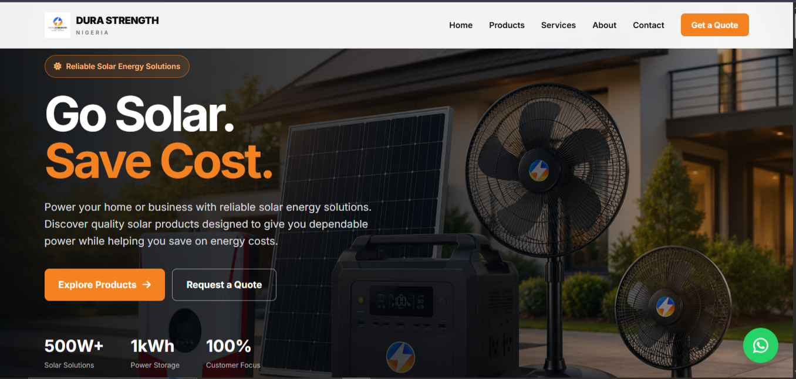
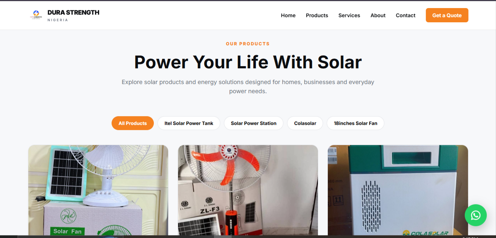
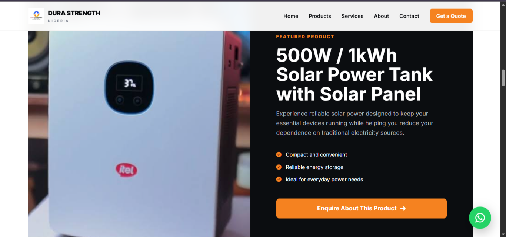
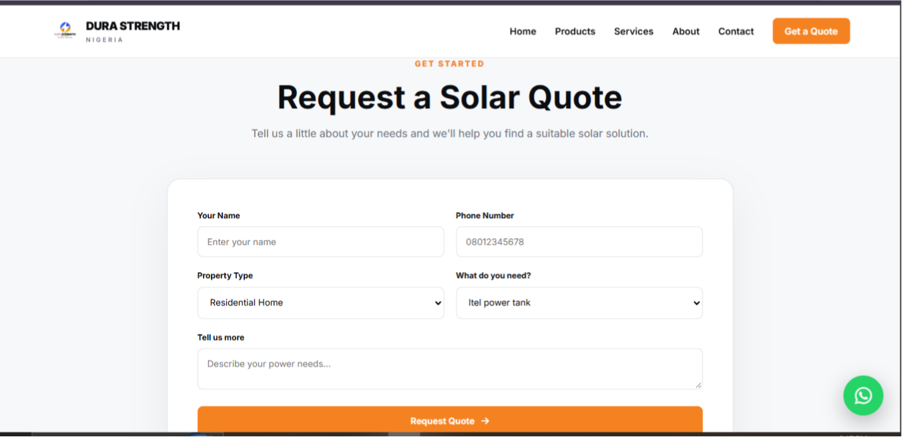
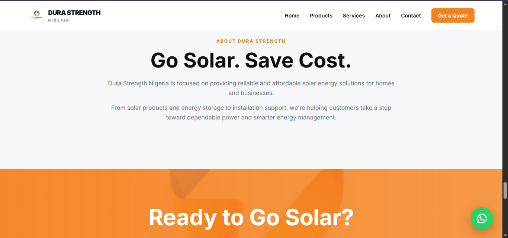

# Dura Strength Nigeria

**Go Solar, Save Cost.**

Dura Strength Nigeria is a solar energy product website built to showcase solar power solutions for homes and businesses. The platform allows customers to explore available products and submit enquiries about their solar energy needs.

The project combines a responsive frontend with a Python Flask backend, an SQLite database, and an administrative dashboard for managing products and customer enquiries.

## Screenshots

### Home Page


### Products


### Featured Product


### Request a Quote


### About


## Features

### Product Catalogue
- Displays available solar energy products.
- Shows product images, descriptions, prices, and categories.
- Retrieves product information dynamically from the database.

### Product Management
- Add new products through the admin dashboard.
- Edit existing product information.
- Upload product images.
- Delete products from the catalogue.

### Customer Quotations
- Allows customers to submit quotation requests.
- Collects customer names, phone numbers, property types, solar requirements, and additional messages.
- Stores submitted enquiries in the database.

### Admin Dashboard
- Admin login and logout functionality.
- View submitted customer enquiries.
- View and manage product listings.
- Display product and enquiry counts.

### Responsive Interface
- Clean, modern interface designed for convenient navigation.
- Responsive styling for different screen sizes.
- Interactive elements powered by JavaScript.

## Technologies Used

| Technology | Purpose |
|------------|---------|
| HTML5 | Website structure |
| CSS3 | Styling and responsive layouts |
| JavaScript | Frontend interactivity |
| Python | Backend application logic |
| Flask | Web framework and routing |
| SQLite | Database storage |
| Jinja2 | Dynamic HTML rendering |

## Project Structure

```
durastrength-website/
├── app.py
├── requirements.txt
├── Procfile
├── templates/
│   ├── index.html
│   ├── admin.html
│   ├── admin_login.html
│   └── edit_product.html
├── static/
│   ├── css/
│   │   └── style.css
│   ├── js/
│   │   └── script.js
│   └── images/
├── screenshots/
└── README.md
```

**Note:** The `images` directory is created automatically when the application initializes. Product images can also be uploaded through the admin dashboard. The SQLite database, `quotes.db`, is created automatically when the application runs.

## Getting Started

Follow these steps to run the project locally.

### Prerequisites
- Python 3 installed.
- Git installed.

### 1. Clone the Repository

```
git clone https://github.com/Tobiloba2104/durastrength-website.git
```

### 2. Navigate to the Project Directory

```
cd durastrength-website
```

### 3. Install the Requirements

```
py -m pip install -r requirements.txt
```

### 4. Configure Environment Variables

For security, configure the following environment variables before running the application:

- `SECRET_KEY` — A secure secret key for Flask sessions.
- `ADMIN_USERNAME` — The administrator's username.
- `ADMIN_PASSWORD` — A strong administrator password.

On Windows PowerShell, for example:

```
$env:SECRET_KEY="your-secret-key"
$env:ADMIN_USERNAME="your-username"
$env:ADMIN_PASSWORD="your-strong-password"
```

Avoid using default credentials in production.

### 5. Run the Application

```
py app.py
```

Open the local address displayed in your terminal in your web browser.

## Database

The application uses SQLite to store product information and customer quotation requests.

The database tables are initialized automatically when the application starts. The application also inserts an initial set of products when the products table is empty.

## Project Objective

This project was developed to provide a practical digital platform for a solar energy business.

It demonstrates the application of frontend development, Python web development, database integration, form handling, file uploads, session-based authentication, and CRUD operations in a real-world business context.

## Future Improvements

- Deploy the application for public access.
- Improve authentication and application security.
- Add product search and filtering.
- Introduce additional customer enquiry management features.
- Explore online payment integration.

## Developer

**Adebesin Oluwatobiloba**
Computer Science graduate | Python Developer | Aspiring Backend Developer

---

*Dura Strength Nigeria — Go Solar, Save Cost.*
